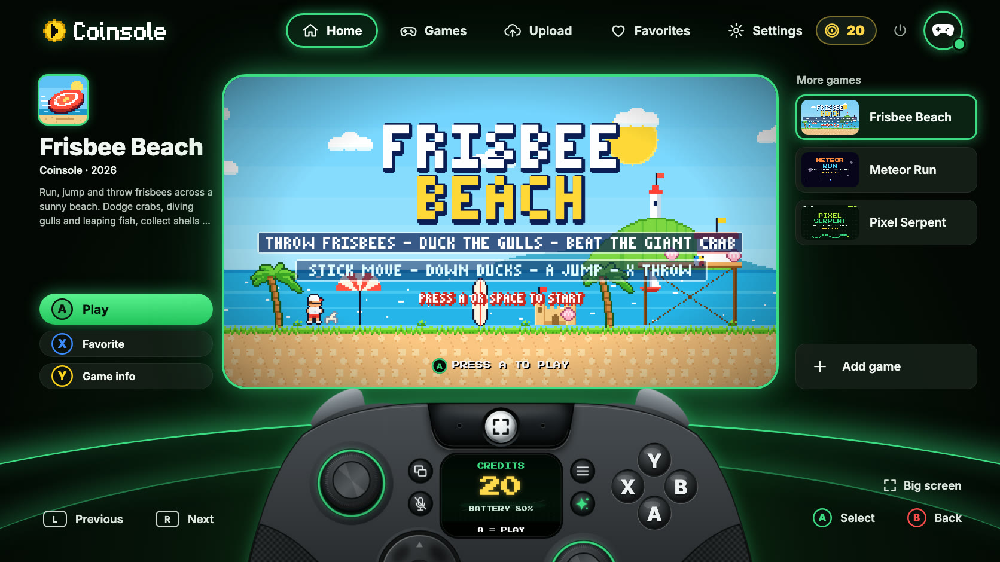
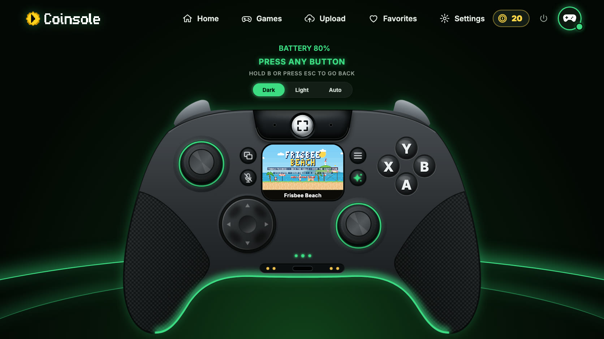
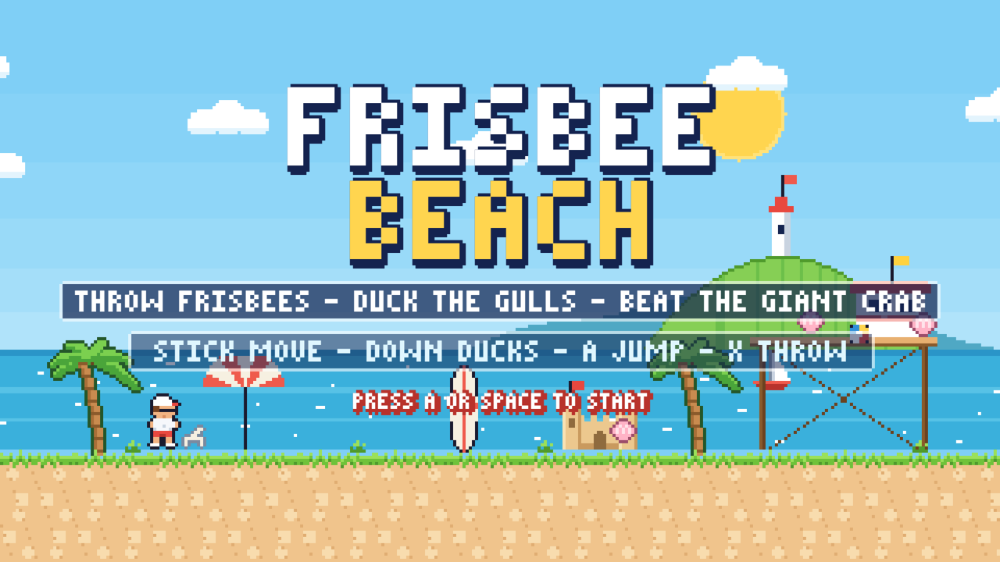
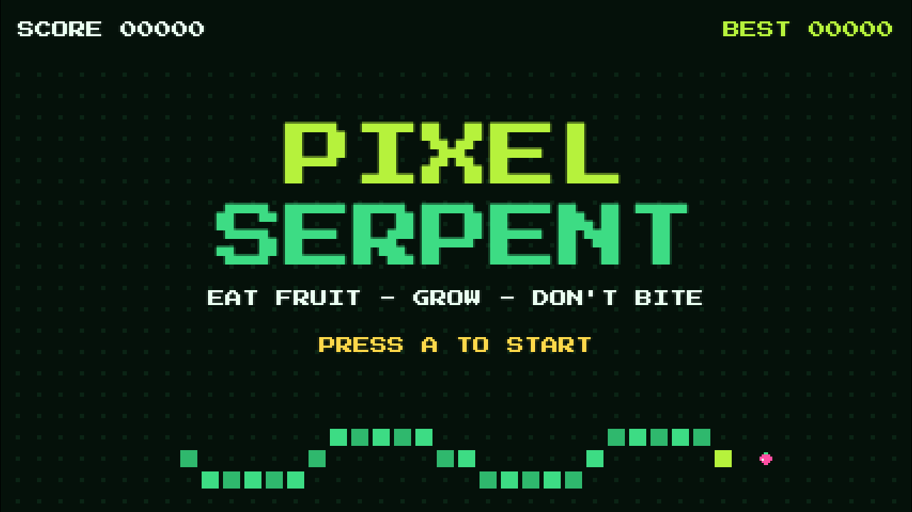
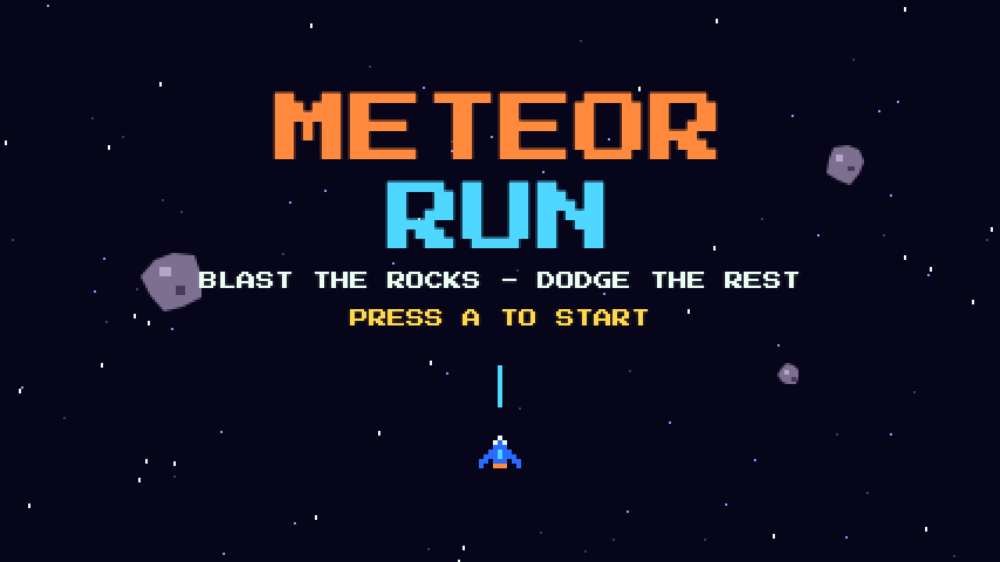

<p align="center"></p>

**Coinsole** turns your Mac into an arcade console. Add your own games and play them on a
arcade-style screen with an Xbox or PlayStation controller, credits and a big-screen mode.



## Download

**[Download Coinsole for Mac](https://github.com/anvibe/coinsole/releases/latest)**, open the disk image and drag
Coinsole onto Applications. It is signed and notarised by Apple, and runs on macOS 12 or later (Apple silicon or Intel).

## Features

- **Your games, one console.** Mac apps, web games (HTML) and game folders, each with a cover and an info card.
- **Xbox and PlayStation controllers.** Bluetooth Xbox and PlayStation (DualSense, DualShock) controllers work everywhere. An on-screen controller mirrors your real one, and a test page shows every button and stick.
- **Two looks.** Dark, with Xbox button names, and Light, with ✕ ○ □ △. Pick one in Settings or on the controller page, or leave it on Auto to follow your controller.
- **Credits.** A token machine and a wallet. Play costs one credit, and continuing in a game costs another.
- **Big screen.** Tap the Xbox or PS button at any time to see the game large, inside a neon arcade cabinet, and play it there.
- **Window or full screen.** A normal Mac window, or a full-screen arcade mode (green button or Ctrl⌘F).
- **Three built-in games:** Frisbee Beach, Pixel Serpent and Meteor Run.



## Built-in games

| | | |
|---|---|---|
|  |  |  |
| **Frisbee Beach:** run, jump and throw frisbees across the beach, and beat the Giant Crab. | **Pixel Serpent:** eat the fruit, grow longer, don't bite yourself. | **Meteor Run:** blast the falling meteors; big ones split. |

## Build and run

You need macOS 12 or later (Apple silicon or Intel) and, to build it, Xcode's command line tools
(`xcode-select --install`).

```bash
git clone https://github.com/anvibe/coinsole.git
cd coinsole
./build.sh
open build/Coinsole.app
```

`./build.sh` creates `build/Coinsole.app` and a `build/Games` folder with the built-in games.
To build somewhere else, pass a folder: `./build.sh ~/Desktop/Coinsole`.

### Make an installer

```bash
./make_dmg.sh
```

This creates `build/Coinsole-1.0.dmg`, signed and notarised if your Mac has the Apple certificate and
credentials described at the top of the script. Open it and drag Coinsole onto Applications. An installed copy
keeps its games in `~/Library/Application Support/Coinsole/Games` (use **Open games folder** in Settings).

The first time it opens a folder on your Desktop or in Documents, macOS asks for permission.
An app you build yourself without an Apple Developer ID certificate is signed ad hoc, so if you pass it to
someone else, macOS blocks it the first time: they open **System Settings → Privacy & Security** and choose
**Open Anyway**.

## Controls

| Controller (Xbox / PlayStation) | Keyboard | Action |
|---|---|---|
| Stick / d-pad, LB / RB (L1 / R1) | Arrows | Choose |
| A / ✕, or Menu / Options | Enter | Play / select |
| B / ○ | Esc | Back |
| X / □ | F | Favorite |
| Y / △ | I | Game info |
| View / Create | C | Token machine (credits) |
| Xbox / PS button (tap) | B (on the home screen), F (in a game) | Big screen on/off |
| Xbox / PS button (hold) | Esc (in a game) | Back to Coinsole |

## Adding games

Drop a game on the window, choose **Add game**, or copy it into the `Games` folder (next to a built app,
or in `~/Library/Application Support/Coinsole` for an installed one).
See [docs/ADDING-GAMES.md](docs/ADDING-GAMES.md) for the formats, covers and info cards. It also explains
how a game can talk to Coinsole (controller, credits, big screen).

## How it's made

- `main.swift`: the Mac app (AppKit and WKWebView). It finds and launches games, reads the controller (GameController), and keeps the credit wallet.
- `ui/`: the interface, one web page (`index.html`) with both looks, the big screen, the token machine and the on-screen controller.
- `games/`: the built-in games, plain HTML5 canvas games.
- `build.sh`, `make_dmg.sh` and `make_icon.swift`: build the app, make the installer and draw the icon.

The interface is a web page and the games are web games, so ports to Windows or Linux mostly need a
new shell around them (for example with Tauri or Electron). Contributions are welcome.

## Author

Made by **Fausto Melchiorre**: [faustomelchiorre.com](https://faustomelchiorre.com/)

- [**Nocodo** by Fausto Melchiorre](https://www.nocodo.it/)
- [**Anvibe**](https://anvibe.it/), an idea by Nocodo by Fausto Melchiorre

If you enjoy Coinsole, you can support it with the **♥ Sponsor** button at the top of this page.

## Licence

- Code: [GNU Affero General Public License v3.0](LICENSE) (AGPL-3.0-only). © 2026 Fausto Melchiorre.
  You may use, change and share it, also commercially. If you share a changed version, or run one that
  people use over a network, you must offer them its source under the same licence.
- Artwork (the built-in games' pixel art, covers and the screenshots): [CC BY-NC 4.0](ARTWORK.md), non-commercial.
- The Coinsole name, logo and app icon are reserved: see [ARTWORK.md](ARTWORK.md).
- Want to use Coinsole under other terms? Get in touch through [faustomelchiorre.com](https://faustomelchiorre.com/).
- Fonts and other third-party material: see [CREDITS.md](CREDITS.md).

"Xbox" is a trademark of Microsoft; "PlayStation", "DualSense" and "DualShock" are trademarks of Sony Interactive Entertainment. Coinsole only uses these names to describe the controllers it supports and is not affiliated with Microsoft, Sony or any game publisher.
